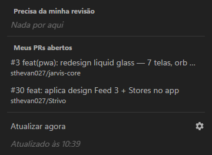
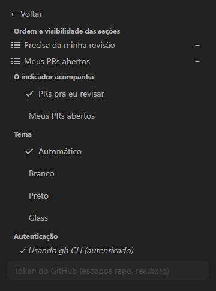
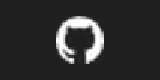
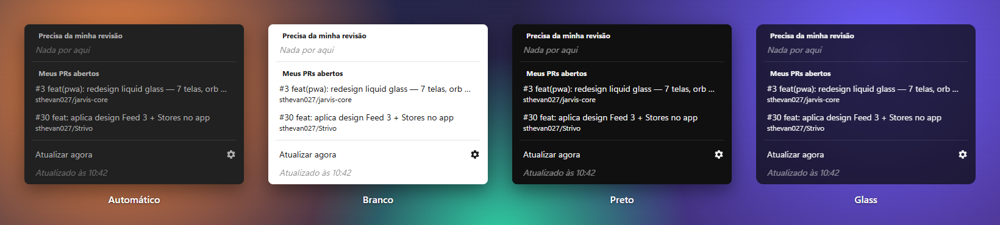
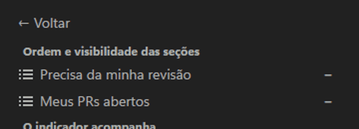

# PR Indicator — Windows

Versão pra bandeja do Windows (e do Linux, veja [abaixo](#linux-kde-xfce-etc)) da extensão GNOME. Tem o mesmo popup, os
mesmos temas e o mesmo painel de configuração inline. Mostra os PRs
esperando a sua revisão e os seus PRs abertos no GitHub, e atualiza sozinha
a cada 60 segundos.

<p align="center">
  
  &nbsp;
  
</p>

### Ícone na bandeja



O ícone é o logo do GitHub. **Ao passar o mouse, ele vira o número de PRs**
da seção escolhida em "O indicador acompanha". Mostra `…` enquanto carrega e
`!` em erro. Tirando o mouse, o logo volta. A bandeja do Windows só tem um
quadrado de 16×16, então o número não cabe ao lado do ícone como no painel
do GNOME. O tooltip também mostra a contagem.

**Clique (esquerdo ou direito):** abre o popup colado ao ícone, do lado
certo da barra de tarefas. Ele funciona com a barra em cima ou embaixo e com
o ícone no `^`. Clicar fora ou apertar `Esc` fecha. Clicar num PR abre no
navegador.

### Temas



- **Automático:** o popup padrão do GNOME Shell. Segue o modo claro/escuro
  do Windows.
- **Branco / Preto:** as mesmas cores do `stylesheet.css` da extensão.
- **Glass:** vidro escuro translúcido, com cantos arredondados, que deixa
  ver o que está atrás do popup.

A troca de tema aplica na hora. Ao entrar ou sair do Glass, o popup é
recriado num instante, já aberto no painel de configuração.

### Painel de configuração

A engrenagem abre o mesmo painel do GNOME:

- ordem e visibilidade das seções (arraste pelo `☰`, use `−`/`+`);
- o que o indicador acompanha;
- o tema;
- a autenticação (`gh` CLI ou token manual).



**Arrastar pra reordenar é animado:**

- a linha acompanha o ponteiro, levantada com sombra;
- a vizinha desliza pra abrir espaço;
- ao soltar, a linha encaixa na vaga (160ms).

Se o Windows estiver com *reduzir animações* ligado, a troca é instantânea.
Clicar no `☰` sem arrastar não muda nada.

Dica: pra deixar o ícone sempre visível, e não escondido no `^`, vá em
*Configurações → Personalização → Barra de tarefas → Outros ícones da
bandeja do sistema* e ligue o **PR Indicator**.

## Linux (KDE, XFCE etc.)

O mesmo app roda no Linux, na bandeja do painel (StatusNotifier, o padrão do
KDE Plasma). No GNOME, prefira a extensão da raiz do repositório. O que muda
em relação ao Windows:

- **Número sempre visível:** o Linux não avisa quando o mouse passa no ícone,
  então o logo do GitHub leva o número num selo no canto. O tooltip também
  mostra a contagem.
- **Clique esquerdo** abre o popup; o **direito** abre um menu com *Abrir*,
  *Atualizar agora* e *Sair*.
- **Posição do popup:** no **X11** o popup abre num canto da tela principal
  (padrão: superior direito; mude com `PR_INDICATOR_CORNER` = `top-right`,
  `top-left`, `bottom-right` ou `bottom-left`). No **Wayland** o app não
  escolhe onde a janela aparece: sem ajuda, o compositor a põe no meio da
  tela. No **KDE Plasma** (KWin) instale o script de posição, que fixa o popup
  no canto superior direito da área útil, abaixo do painel:

  ```bash
  ./linux/install-kwin-position.sh            # instala e ativa
  ./linux/install-kwin-position.sh --remove   # desativa e remove
  ```

  Ele instala `~/.local/share/kwin/scripts/pr-indicator-position/`, liga em
  `kwinrc` e só mexe na janela do PR Indicator (`pr-indicator-windows`).
- **Wayland:** o app usa Wayland nativo quando a sessão é Wayland. Não force
  XWayland: em alguns compositores (como o KWin do KOS) o popup nunca aparece. `PR_INDICATOR_OZONE=x11`
  ou `wayland` sobrepõe a escolha.
- **Cor do ícone:** segue o tema claro/escuro do sistema. Se o seu painel tem
  outra cor, force com `PR_INDICATOR_TRAY_COLOR=#ffffff`.
- **Autostart:** grava `~/.config/autostart/pr-indicator.desktop`. No
  AppImage, liga sozinho na primeira execução, como no `.exe` instalado.
- **Token manual:** é cifrado pelo cofre do sistema (KWallet ou libsecret
  via `safeStorage`). Sem cofre, use o `gh` CLI.

### Rodar a partir do código

```bash
cd windows
npm install        # ou: bun install
node node_modules/electron/install.js   # se o binário do Electron não baixou
npm start
npm run autostart:enable    # desliga com: npm run autostart:disable
```

### Gerar o AppImage

```bash
npm run dist:linux     # saída: windows/dist/PR-Indicator-x.y.z-x86_64.AppImage
chmod +x dist/*.AppImage && ./dist/*.AppImage
```

Os dados ficam em `~/.config/PR Indicator/` (`settings.json` e `token.bin`).

## Requisitos

- Windows 10/11. O tema Glass é um vidro escuro translúcido (sem desfoque),
  com cantos arredondados, que deixa ver o que está atrás do popup.
- [Node.js](https://nodejs.org/) 20+ e [Bun](https://bun.sh/) (gerenciador
  de pacotes).
- [GitHub CLI](https://cli.github.com/) autenticado (`gh auth login`), **ou**
  um token manual configurado no painel.

## Instalação

### Pelo instalador (recomendado)

Baixe na página de [Releases](https://github.com/sthevan027/gnome-pr-indicator/releases):

- **`PR-Indicator-Setup-x.y.z.exe`:** instala só pro seu usuário, em
  `%LOCALAPPDATA%\Programs\`, sem pedir administrador. Na primeira vez que
  abre, já liga o *iniciar com o Windows*.
- **`PR-Indicator-x.y.z-portable.exe`:** roda sem instalar.

O `.exe` não é assinado digitalmente. Na primeira vez, o Windows pode
mostrar "O Windows protegeu o computador": clique em *Mais informações →
Executar assim mesmo*.

Pra desligar ou religar o início automático:

```powershell
& "$env:LOCALAPPDATA\Programs\pr-indicator-windows\PR Indicator.exe" --autostart=disable
& "$env:LOCALAPPDATA\Programs\pr-indicator-windows\PR Indicator.exe" --autostart=enable
```

Pra desinstalar: *Configurações → Aplicativos → PR Indicator*.

### A partir do código

```powershell
cd windows
bun install
# o Bun não roda scripts de instalação por padrão; se o binário do
# Electron não tiver baixado (node_modules/electron/dist vazio):
node node_modules/electron/install.js
bun run start
bun run autostart:enable    # desliga com: bun run autostart:disable
```

Pra gerar o instalador e a versão portátil em `windows/dist/`:

```powershell
bun run dist
```

## Onde ficam os dados

Ficam em `%APPDATA%\PR Indicator\`:

- `settings.json`: ordem e seções ocultas, tema e seção do indicador. Usa as
  mesmas chaves do schema GSettings do GNOME.
- `token.bin`: o token manual, cifrado pelo cofre do Windows (DPAPI via
  `safeStorage`). Nunca fica em texto plano. Só é usado se o `gh` CLI não
  estiver autenticado.

Erros: como no GNOME, uma falha de rede ou da API (timeout, 5xx, rate
limit) mantém a última lista boa, e só a linha de status mostra o erro.
A diferença é a falha de **autenticação** (sem `gh` e sem token, ou token
revogado): nesse caso a lista é limpa.

A rede usa a pilha do Chromium (`net.fetch`), então respeita o proxy e os
certificados configurados no Windows.

## Estrutura

```
src/main.js             processo principal: bandeja, popup, polling, IPC
src/preload.cjs         ponte segura main ↔ popup (contextIsolation)
src/github-client.js    buscas no GitHub, token (gh → manual), AuthError
src/settings-store.js   settings.json + token cifrado
src/badge.js            texto do hover/tooltip, detecção do mouse
src/popup-position.js   onde abrir o popup conforme a barra de tarefas
src/autostart.js        entrada "abrir com o Windows"
src/renderer/           popup (HTML/CSS/JS) e desenho do ícone da bandeja
tests/                  testes com `node --test` (bun run test)
shared/                 lógica compartilhada com o GNOME (reexporta ../lib; no .exe vira o arquivo real)
build/icon.png          ícone do executável
```

A lógica de ordem e visibilidade das seções é a mesma da extensão,
importada direto de `../lib/sectionsConfig.js`.

## Testes

```powershell
bun run test
```

Modo de teste do app. Usa variáveis de ambiente e não mexe nas suas
configurações reais:

| Variável | Efeito |
|---|---|
| `PR_INDICATOR_USER_DATA` | pasta de dados isolada |
| `PR_INDICATOR_FAKE` | usa um JSON no lugar do GitHub: `{"ghAuth": true, "review": [...], "mine": [...], "error": "auth" \| "<mensagem>"}`; no token fake, `valido` é aceito |
| `PR_INDICATOR_SNAPSHOT` | salva `popup-pr.png`, `popup-config.png`, `tray-icon.png`, `tray-hover.png`, `tooltip.txt` e `bounds.json` nessa pasta e fecha |
